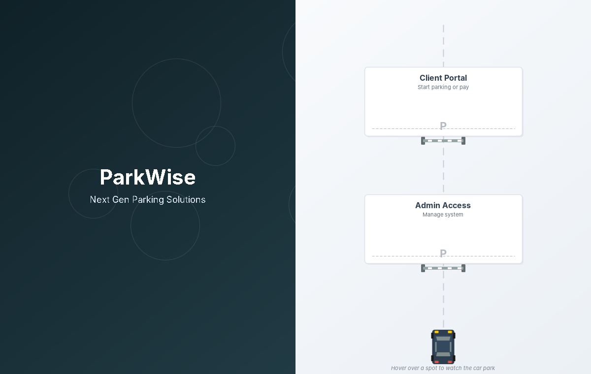
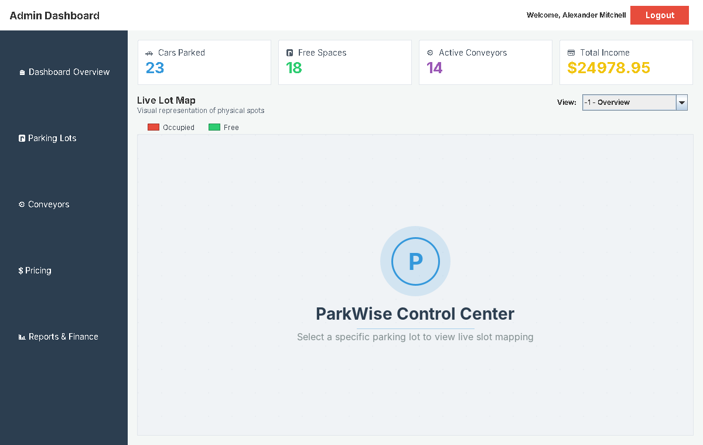
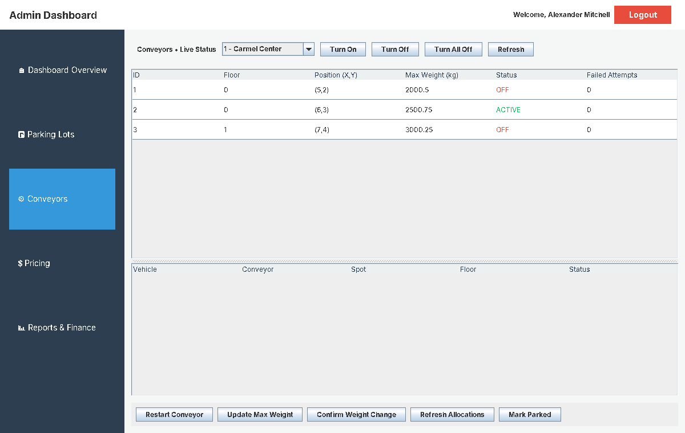
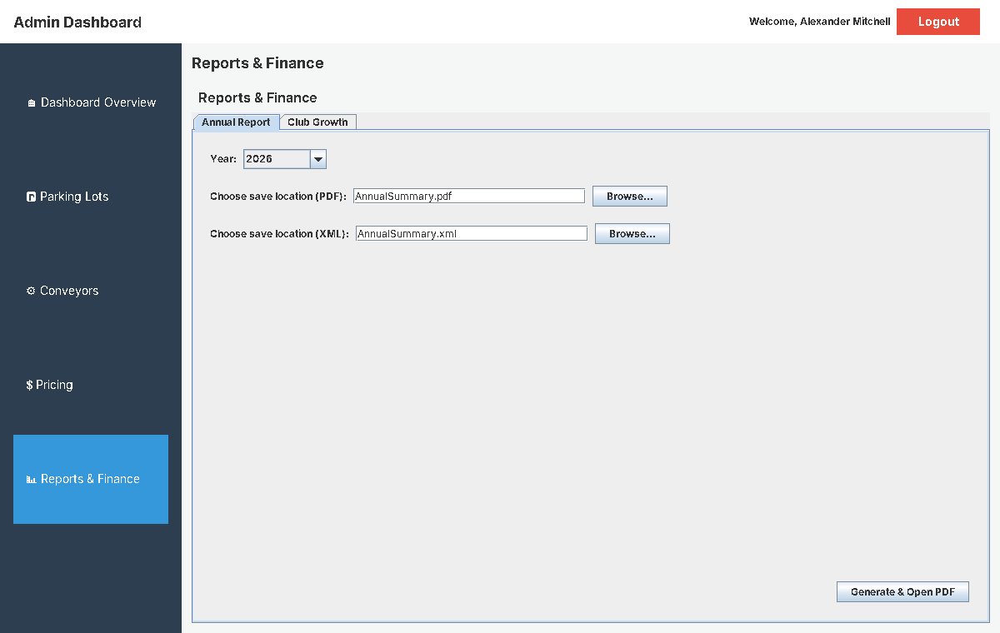

# ParkWise — Automated Parking Facility Management System

A Java desktop information system for an **automated, conveyor-based parking facility**: it registers arriving vehicles, assigns each one to a conveyor and a parking spot, tracks parking sessions in real time, bills customers and produces management reports.

Built as the semester project of the **Information Systems Design and Development** course at the **University of Haifa** (grade: **95/100**), by a team of two.



> **Try it yourself:** download the ready-to-run demo from the [Releases](../../releases) page — see [Running the project](#running-the-project).

---

## At a glance

| | |
|---|---|
| **Language** | Java (Swing desktop UI) |
| **Size** | 41 classes · ~8,100 lines of code |
| **Architecture** | Three-layer **Boundary – Control – Entity (BCE)** |
| **Database** | Microsoft Access, **11 relational tables**, accessed through **JDBC** (UCanAccess) with 55+ SQL statements |
| **Reporting** | **JasperReports** (JRXML → PDF / XML) |
| **Configuration** | JSON price lists (multi-year pricing) |

## Features

- **Two role-based interfaces** — a password-protected administrator dashboard and a client portal.
- **Vehicle entry flow** — registration from front, side and rear photos, with a mock recognition step that derives the vehicle's color, size and weight from the photo file names (a placeholder for real image recognition).
- **Smart allocation** — every arriving vehicle is matched to the best conveyor and parking spot (see below).
- **Live operations view** — an occupancy map in the admin dashboard (red = occupied, green = free), an animated gate barrier and a live animation of the vehicle being moved to its spot.
- **Billing** — each parking session is priced from the lot's current price list (first hour, additional hours, full day); price lists are imported from JSON files, and every payment is stored as a receipt.
- **Loyalty club** — member registration, a 10% discount on parking fees, and a club-growth report.
- **Management reporting** — an annual summary report exported to PDF and XML with JasperReports.

## Screenshots

| Admin dashboard | Conveyor management |
|---|---|
|  |  |

| Reports & finance |
|---|
|  |

## Architecture (Boundary – Control – Entity)

```
┌────────────────────────────────────────────────────────────┐
│  boundary/   Swing UI — admin dashboard, client portal,    │
│              entry simulation, gate view, reports screens  │
└───────────────────────────┬────────────────────────────────┘
                            │ user actions
┌───────────────────────────▼────────────────────────────────┐
│  control/    Business logic — allocation, parking sessions,│
│              pricing, loyalty club, conveyors, reporting    │
└───────────────────────────┬────────────────────────────────┘
                            │ domain objects
┌───────────────────────────▼────────────────────────────────┐
│  entity/     Domain model — Vehicle, ParkingSpot, Conveyor, │
│              ParkingSession, Client, ClubMember, Receipt…   │
├────────────────────────────────────────────────────────────┤
│  utils/      DatabaseConnection (JDBC + SQL), helpers       │
└───────────────────────────┬────────────────────────────────┘
                            │ JDBC (UCanAccess)
                    ┌───────▼────────┐
                    │ MS Access DB   │  11 tables
                    └────────────────┘
```

The UI never talks to the database directly: screens call controllers, controllers work with entities, and all SQL lives in the data-access layer.

## Data model (11 tables)

| Table | Purpose |
|---|---|
| `Vehicle` | Registered vehicles — size, weight and owner |
| `Client` | Customers and contact details |
| `ClubMember` | Loyalty-club members — membership date and status |
| `ParkingLot` | Parking facilities |
| `ParkingSpace` | Individual spots — floor, position, size, occupancy |
| `Conveyor` | Automated conveyors — capacity, position, status |
| `ParkingSession` | Entry / exit records for each parking stay |
| `PriceList` | Pricing rules by year |
| `PreferredSelection` | Parking lot a client selected, with selection date |
| `Receipt` | Issued receipts |
| `Administrator` | System administrators (login) |

## The allocation algorithm

Implemented in [`control/AllocationService.java`](src/control/AllocationService.java):

1. **Filter conveyors** — keep only `ACTIVE` conveyors whose maximum weight can carry the vehicle.
2. **Filter spots** — keep only available spots large enough for the vehicle's size.
3. **Score every (conveyor, spot) pair** — Euclidean distance between the conveyor's current position and the spot, plus a penalty when the spot is on a different floor, so same-floor placements are preferred. Busy conveyors are skipped.
4. **Pick the minimum-cost pair**, mark the conveyor as busy and the spot as occupied.
5. **Simulate the transport** with a timer; when it completes, the vehicle is marked as parked and the conveyor returns to `ACTIVE`.

Shared allocation state is guarded with `synchronized` blocks, because the UI and the timers update it concurrently.

## Project structure

```
src/
  ParkWiseApplication.java   entry point
  boundary/                  Swing screens and panels
  control/                   controllers and services
  entity/                    domain classes
  reports/                   JasperReports template (AnnualSummary.jrxml)
  utils/                     DatabaseConnection and helpers
json/                        sample price lists (import from the Pricing screen)
car-photos/                  sample vehicle photos for the entry flow
database/                    demo database with fictional data (parkwise.accdb)
docs/screenshots/            application screenshots
```

## Running the project

**Requires Java 21 or later.**

### Quick start (no setup)

1. Download `ParkWise-demo.zip` from the [Releases](../../releases) page and unzip it.
2. Double-click `ParkWise.jar`, or run `java -jar ParkWise.jar` from the unzipped folder.
3. Log in to **Admin Access** with the demo account — username `admin1`, password `2024`.

The demo uses a Microsoft Access database with **fictional sample data**.

### From source

1. Open the project in Eclipse or IntelliJ IDEA (JDK 21).
2. Add these libraries to the classpath: **UCanAccess 5.0.1** (with jackcess, hsqldb, commons-lang3 and commons-logging), **JasperReports 5.6.1** (with its commons, iText and jfreechart dependencies) and **org.json**.
3. Run `ParkWiseApplication` with the project root as the working directory, so the app finds `database/parkwise.accdb`.

Test photos for the entry flow follow the naming convention `front_photo_<color>_<size>_<weight>kg.png` — see `car-photos/`.

## Team

Built by **Mouran Mattar** and a project partner as part of the B.Sc. in Information Systems (AI specialization), University of Haifa.

## Tech stack

`Java` · `Swing` · `JDBC` · `UCanAccess` · `Microsoft Access` · `SQL` · `JasperReports` · `JSON` · `UML`
